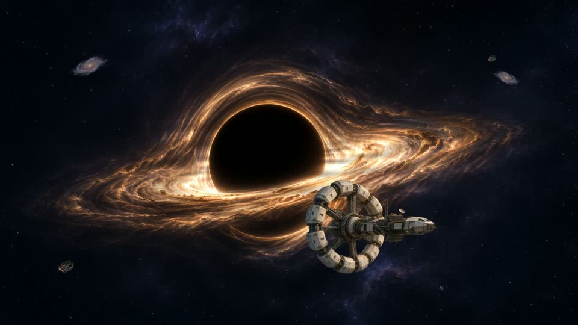

# Neo TVLauncher

Clean up general apps on **Google TV, Android TV and compatible TV boxes**, then install a custom TV home launcher — from an **Android phone** or a **Windows menu-driven CLI**.

## Download

| What you need | Download |
| --- | --- |
| Android phone installer/support app | [Neo TVLauncher Companion 1](https://github.com/diazneoones82/Neo-TVos/releases/download/v1/Neo-TVLauncher-Companion-1.apk) |
| Windows menu + launcher APK | [Windows CLI bundle](https://github.com/diazneoones82/Neo-TVos/releases/download/v1/Neo-TVLauncher-1-Windows-CLI.zip) |
| Launcher APK only — install this on the TV | [Neo TVLauncher 1](https://github.com/diazneoones82/Neo-TVos/releases/download/v1/Neo-TVLauncher-1.apk) |

[All releases and SHA256 checksums](https://github.com/diazneoones82/Neo-TVos/releases) · [Android phone guide](docs/ANDROID.md) · [Windows guide](docs/WINDOWS.md)

**Companion goes on your phone. Neo TVLauncher goes on your TV.**

## Prepare your TV once

1. Open TV **Settings → System / Device preferences → About**.
2. Select **Build** seven times to enable Developer options. Menu names vary by brand.
3. Enable **USB debugging**. For network connections, also enable the TV's **Network / ADB debugging** option if available.
4. Put the phone/computer and TV on the same local network. The TV can use Ethernet while the phone/computer uses Wi-Fi.
5. Find the TV's IP address in Network settings. Approve its debugging authorization prompt when connecting.

An Ethernet cable by itself does not enable debugging. Use the ADB port shown by your TV; **5555** is common for classic Network ADB.

## Use an Android phone

1. Download and install **Neo TVLauncher Companion** on the phone. If Android asks, allow installation from the browser/file manager you used.
2. Choose **Connect using Wi-Fi / Ethernet**, enter the TV IP and classic ADB port, then approve debugging on the TV.
3. Check the detected **brand, model and serial**.
4. Choose **Review general apps**. Cards show the real **app name and package name**; required Android components, Settings and Home providers are excluded.
5. Tap an app and confirm its removal individually, or Cancel. Nothing is automatically selected for deletion.
6. Choose **Install Neo TVLauncher** and wait for success.
7. Choose **Set Neo as Home**. If the TV keeps its OEM default launcher, use the separately confirmed **Home-button compatibility** option, then press Home on the TV remote.

The original launcher stays installed. The companion also has a USB/OTG connection option for TVs with a supported USB device/debug port. [Detailed phone instructions and connection limits →](docs/ANDROID.md)

## Use Windows

1. Download and **extract the entire Windows CLI ZIP**.
2. Download [Android Platform Tools](https://developer.android.com/tools/releases/platform-tools). Put `platform-tools` beside the menu, or choose `adb.exe` using option **17**.
3. Double-click **Start-Neo-TVLauncher.cmd**.
4. Select **1** to connect to the intended TV, then **4** to scan it.
5. Select **5** to install/update without cleanup, or **6** to install and review optional app cleanup.
6. Each menu action explains what it does and asks **Y/N**. **Enter means No.** Cleanup confirms the exact selected package list again before removal.

If your TV uses pairing-code wireless debugging, Windows option **2** handles pairing and the separate connection address. [Windows options and recovery →](docs/WINDOWS.md)

## Launcher features

- Glass-style home screen with categories, favorites, app ordering, themes and icon-pack support.
- Live/dual world clocks, countdowns and a themed four-digit PIN keypad.
- Optional per-app PIN access windows in 15-minute steps; background expiry uses Neo's TV accessibility service.
- Screensaver delay choices from **2 to 30 minutes**: glowing custom text, animated lake, cinematic space loop, or a custom image.
- Optional breathing-blue spaceship engine exhaust in Screensaver settings.
- The phone companion uses the same glass theme and lists general apps with their names and package names.

## Compatibility and important limits

- TV: Android TV / Google TV **Android 7+ (API 24+)**. Phone: **Android 8+ (API 26+)**. Windows: PowerShell 5.1 or newer.
- The phone companion supports **classic Network ADB** and USB ADB. **Pairing-code/TLS-only ports are not supported by the phone app**; use Windows pairing or a supported USB route first.
- USB requires phone OTG/host support and a TV **device/debug port**. Many TV USB-A sockets are host-only. Wired phone-to-TV transfer has not been hardware-tested; the network phone-to-TV workflow has been tested.
- Uncertified Android boxes that do not identify as TV devices may be rejected. LG webOS and Samsung Tizen cannot install this Android APK.
- Cleanup may delete app data/accounts. Check the target identity and selected apps first. Core/system packages are protected; reviewed optional preinstalled media apps can still appear.
- Home-button compatibility and app-lock expiry depend on the TV's accessibility service. App locks are launcher controls, not device-owner parental management. OEM behavior can differ.

## Source, builds and credits

[Build instructions](docs/BUILDING.md) · [Validation](docs/VALIDATION.md) · [Visual credits and generation prompts](docs/VISUAL-CREDITS.md)

The current runtime uses Neo-authored home, input, symbol and weather modules with separate Binder workers for catalog, weather and theme validation. Android platform fonts supply the typography. Source is licensed under **Apache 2.0**; see [NOTICE](NOTICE). The cinematic scene uses an original AI-generated black hole and galaxies, with custom orbital-flow animation and the existing generated spacecraft and debris. No external visualization or film footage is packaged. [Architecture and replacement validation](docs/ARCHITECTURE.md).

Signing keys, ADB private keys, device reports and personal screenshots are not published. APKs are provided as GitHub Release assets rather than committed to the source tree.
